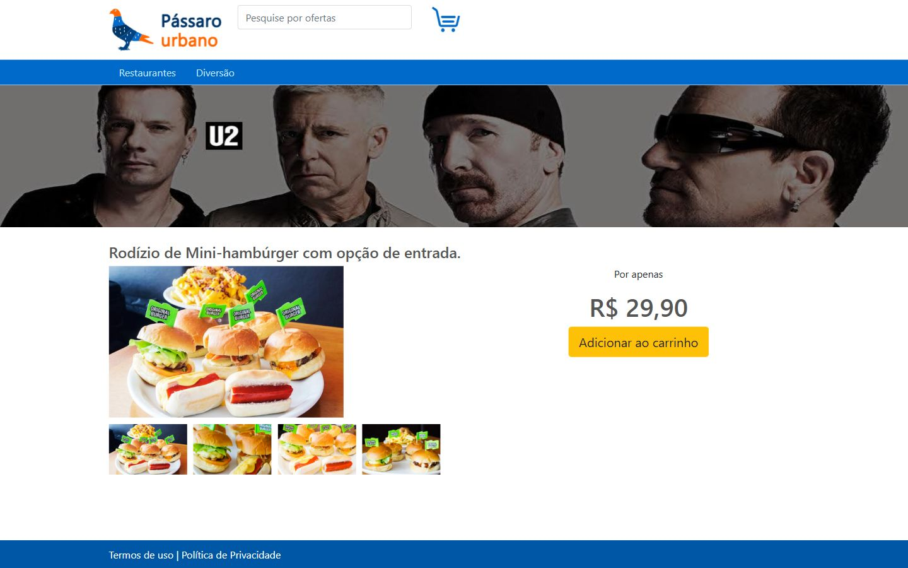

# Pássaro Urbano Portal de Ofertas

Aplicação Angular de estudo inspirada em um portal de ofertas. A interface apresenta promoções, organiza ofertas de restaurantes e diversão e mostra os detalhes, as instruções de uso e a localização de cada oferta.

**Categoria:** Frontend · Aplicação web · Consumo de API simulada.

## Tecnologias principais

- TypeScript
- Angular 11
- Bootstrap 4
- JSON Server

## Funcionalidades

- Mostrar ofertas em destaque na página inicial.
- Navegar pelas áreas de restaurantes e diversão.
- Consultar os detalhes e o preço de uma oferta.
- Abrir as seções “Como usar” e “Onde fica”.
- Preencher uma ordem de compra como exercício de formulário.

O código não demonstra uma integração com um provedor real de pagamentos. O nome apresentado na interface é **Pássaro Urbano**, embora o repositório se chame `peixe-urbano-angular`.

## Fonte dos dados

O arquivo `banco-de-dados.json` acompanha o repositório e serve de base para JSON Server. A API de demonstração expõe coleções como `/ofertas`, `/como-usar` e `/onde-fica`. Esse servidor simula a fonte de dados do portal e não é um backend Spring.

## Executar

Use Node.js compatível com Angular 11; as capturas foram produzidas com Node.js 14. Instale as dependências e inicie a interface:

```bash
npm install
npm start
```

Em outro terminal, na raiz do repositório:

```bash
npx json-server@0.16.3 --watch banco-de-dados.json --port 3000
```

Acesse `http://localhost:4200`. A constante de URL utilizada pelo serviço de ofertas deve apontar para a porta do JSON Server. Se a porta 3000 já estiver ocupada, escolha outra e ajuste a configuração.

## Organização

`ofertas.service.ts` centraliza o consumo dos dados. As pastas `home`, `restaurantes`, `diversao`, `oferta` e `ordem-compra` contêm os fluxos da interface, com rotas definidas em `app-routing.module.ts`.

## Execução das capturas

O JSON Server foi iniciado na porta 4300 e o serviço Angular foi apontado para essa porta somente na cópia local. A página inicial carregou as ofertas do arquivo original, e uma oferta foi aberta para a segunda captura.

## Relação com outros projetos

O arquivo de dados pertence ao próprio projeto. Não foi identificado um backend separado desta aplicação entre os repositórios da coleção.

## Capturas do sistema

Capturas reais da interface em execução local. Nova coleta em 12–13/10/2026, com enquadramento fixo de **1440 × 900 pixels (web)**.

### Ofertas na página inicial


### Detalhes da oferta



## Histórico

Repositório criado no GitHub em **2021-04-20**. Essa data identifica a criação do repositório; não comprova o início nem a conclusão do desenvolvimento.
